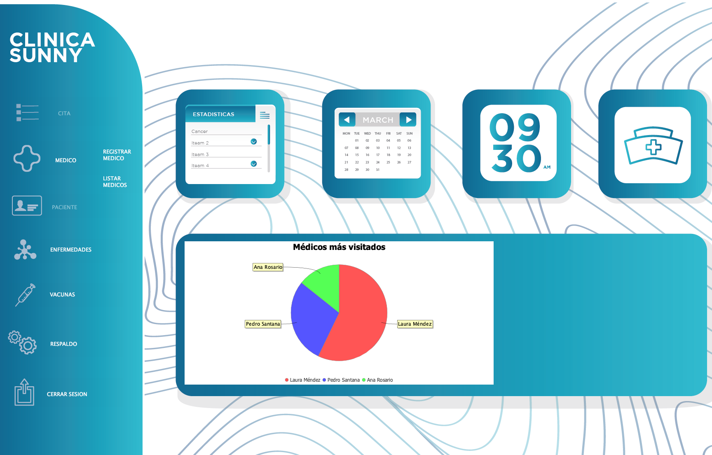
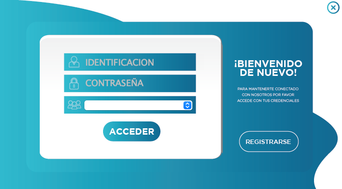
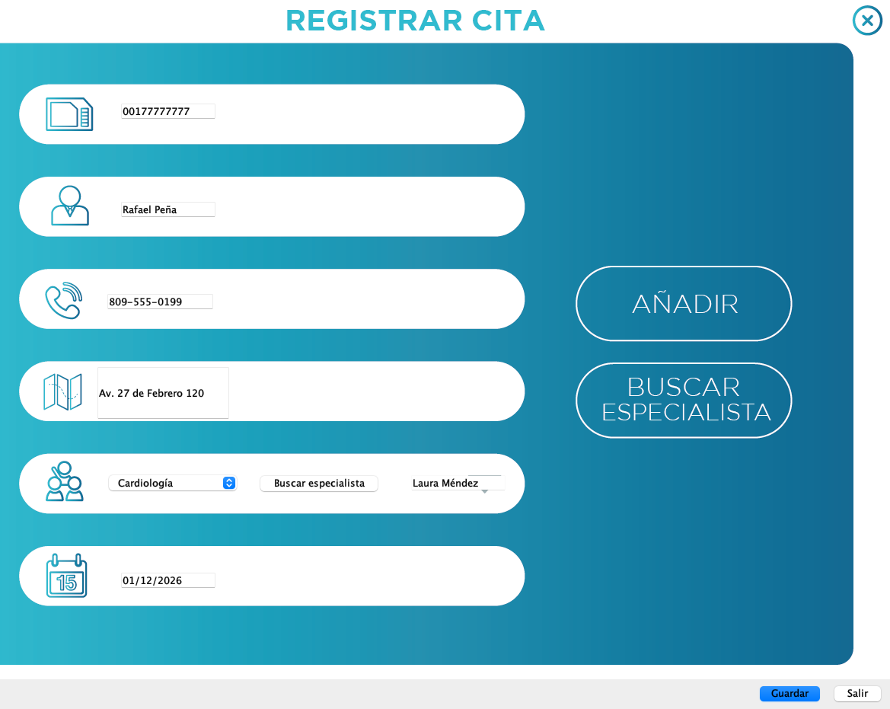
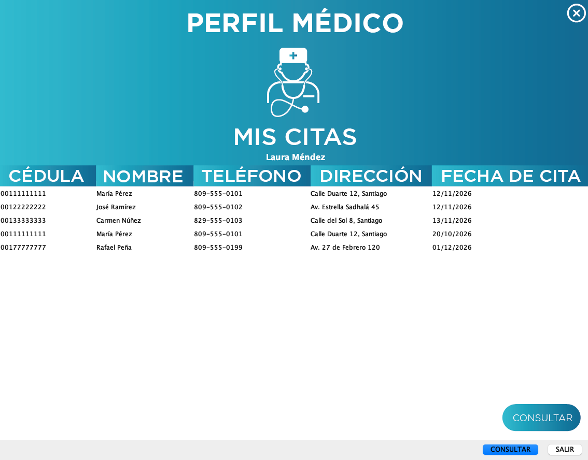
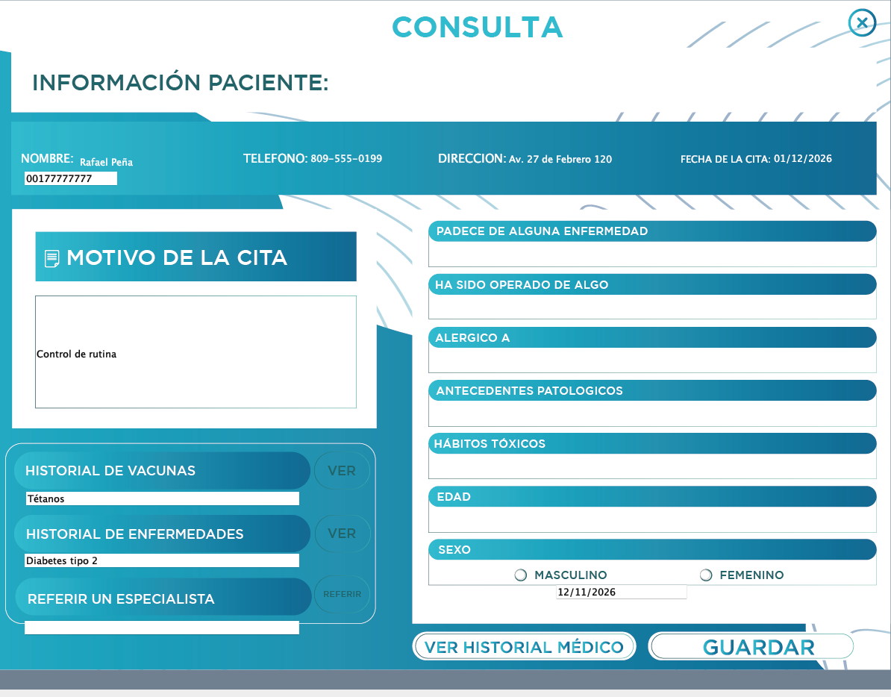
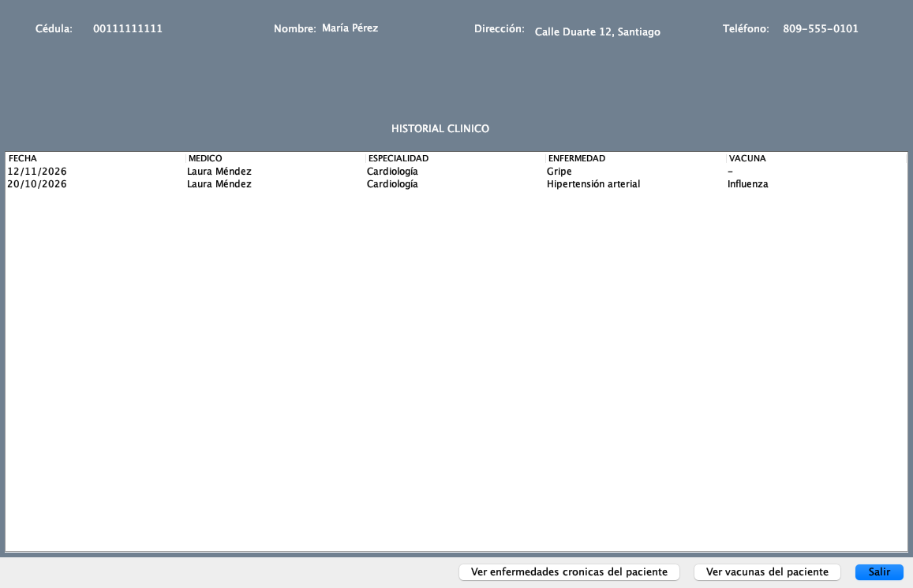
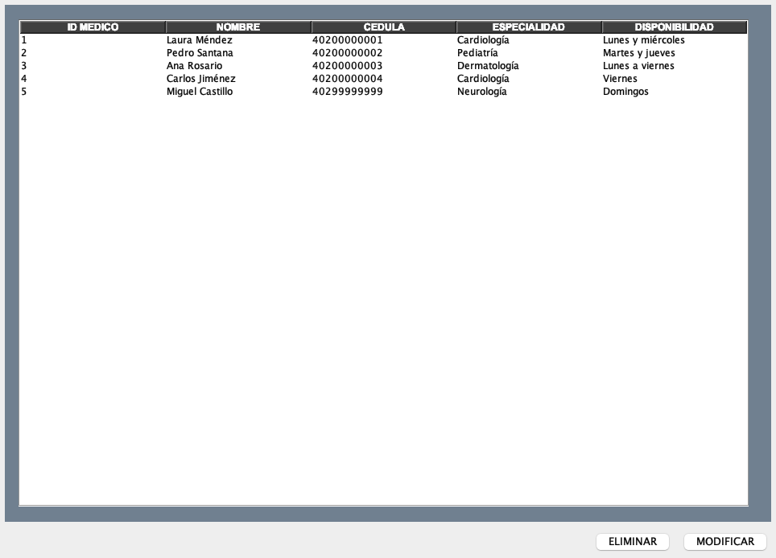

# Clínica Sunny

[](https://github.com/Cris-Estrella-Dev/ProyectoFinal_POO/actions/workflows/ci.yml)

Sistema de escritorio para la gestión de una clínica: citas, consultas médicas, historial
clínico de pacientes, médicos, enfermedades y vacunas. Hecho con **Java Swing** y **MySQL**.

Nació en 2023 como proyecto final de la asignatura de Programación Orientada a Objetos y
fue puesto al día en 2026: build reproducible con Maven, dependencias actuales, base de
datos lista con un comando y los flujos principales funcionando de punta a punta.



## Qué hace

La aplicación tiene tres tipos de usuario, y cada uno ve habilitada solo su parte del menú:

| Rol | Puede |
| --- | --- |
| **Admin** | Registrar, modificar, listar y eliminar médicos · registrar enfermedades (crónicas o no) y vacunas · respaldar los médicos |
| **Secretaria** | Registrar citas eligiendo la especialidad y el especialista |
| **Médico** | Ver sus citas · abrir la consulta de un paciente, registrar el diagnóstico y la vacuna aplicada · ver sus pacientes y el historial clínico de cada uno (consultas, enfermedades crónicas y vacunas) |

Además:

- **Gráfico** en la pantalla principal con las citas registradas por médico (JFreeChart).
- **Respaldo por sockets**: la lista de médicos viaja por un socket TCP a un servidor de
  respaldo, que la escribe en `respaldos/medicos_respaldo.txt`.
- **Interfaz propia**: cada pantalla usa un fondo diseñado a medida, con los botones del
  diseño activados mediante zonas de clic transparentes.

| | |
| --- | --- |
|  |  |
|  |  |
|  |  |

## Cómo ejecutarlo

Requisitos: **JDK 8 o superior** y **Docker** (para la base de datos). No hace falta
instalar Maven: el repositorio incluye el wrapper.

```bash
# 1. Base de datos MySQL con el esquema y datos de demostración
docker compose up -d

# 2. Compilar y empaquetar
./mvnw package

# 3. Ejecutar
java -jar target/clinica-sunny.jar
```

En Windows se usa `mvnw.cmd` en lugar de `./mvnw`.

### Usuarios de demostración

| Rol | Identificación | Contraseña |
| --- | --- | --- |
| Admin | `00100000001` | `admin123` |
| Secretaria | `00100000002` | `secre123` |
| Médico | `40200000001` | `medico123` |

En el inicio de sesión hay que elegir también el rol en la lista desplegable. Desde
**Registrarse** se pueden crear más usuarios; un usuario de tipo Médico queda asociado al
médico cuya cédula coincide con su identificación.

### Usar otra base de datos

La conexión se configura con variables de entorno. Sin ellas se usa la base de Docker.

| Variable | Valor por defecto |
| --- | --- |
| `DB_URL` | `jdbc:mysql://localhost:3306/clinicasunny` |
| `DB_USER` | `clinica` |
| `DB_PASSWORD` | `clinica` |

Para un MySQL propio, se crea la base y se cargan los scripts de [`database/`](database):

```bash
mysql -u root -p -e "CREATE DATABASE clinicasunny CHARACTER SET utf8mb4"
mysql -u root -p clinicasunny < database/01-esquema.sql
mysql -u root -p clinicasunny < database/02-datos-demo.sql
```

Si el puerto 3306 ya está ocupado, se puede publicar el contenedor en otro:

```bash
DB_PORT=3307 docker compose up -d
DB_URL=jdbc:mysql://localhost:3307/clinicasunny java -jar target/clinica-sunny.jar
```

Para empezar de cero con los datos de demostración: `docker compose down -v` y de nuevo
`docker compose up -d`.

## Cómo está hecho

```
src/main/java/
├── accesoDatos/      Conexión, lecturas (CargarDatos), escrituras (GuardarDatos)
│                     y el servidor y cliente de respaldo por sockets
└── visual/           Ventanas Swing: Login, Principal y un diálogo por pantalla
src/main/resources/
└── imagenes/         Fondos de las pantallas
src/test/java/        Pruebas (JUnit 5)
database/             Esquema y datos de demostración
docs/capturas/        Capturas de este README
```

- **Java 8+** · Swing · JDBC con sentencias preparadas
- **MySQL 8** (Connector/J) · siete tablas: `usuarios`, `medicos`, `citas`, `consulta`,
  `paciente`, `enfermedad`, `vacuna`
- **JFreeChart** para el gráfico
- **Maven** (con wrapper) · JAR ejecutable con todas las dependencias
- **GitHub Actions**: compila y prueba en JDK 8, 17 y 21, y verifica que el esquema carga
  en MySQL

```bash
./mvnw verify    # compila, ejecuta las pruebas y genera el JAR
```

## Limitaciones conocidas

Es un proyecto académico y conserva decisiones de ese contexto:

- Las contraseñas se guardan en texto plano y cualquiera puede registrarse con cualquier rol.
- De la consulta solo se guardan el diagnóstico, la vacuna y la fecha; el resto del
  formulario (motivo, alergias, antecedentes…) y el botón "Referir" son parte del diseño
  pero no se almacenan.
- La pantalla principal está diseñada para 1728 × 1105; en pantallas más pequeñas aparecen
  barras de desplazamiento.

## Créditos

- [Cristian Estrella](https://github.com/Cris-Estrella-Dev) — interfaz, pantallas y lógica de la aplicación.
- [Nawel](https://github.com/nawelyi) — capa inicial de acceso a datos.
